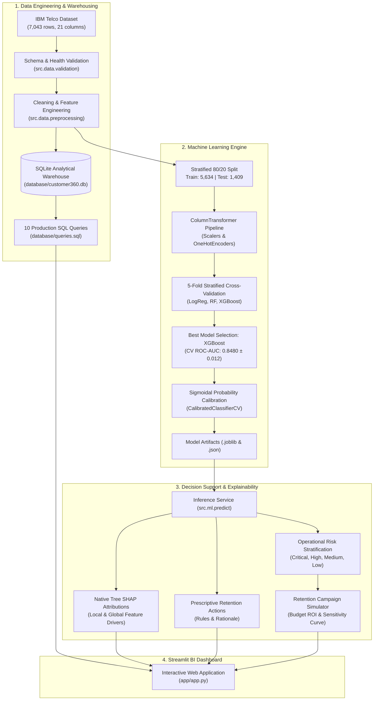

# CUSTOMER360 AI — Customer Churn Prediction & Retention Decision Intelligence Platform

[](https://www.python.org/)
[](https://scikit-learn.org/)
[](#-explainable-ai-xai--tree-shap-attribution)
[](https://www.sqlite.org/)
[](https://streamlit.io/)
[](https://docs.pytest.org/)
[](LICENSE)

An enterprise-grade, end-to-end Data Science and Decision Intelligence platform engineered to diagnose customer churn risk, explain individual customer attrition drivers with **Tree SHAP**, quantify enterprise monthly revenue exposure, and simulate targeted retention campaign ROI using **7,043 authentic IBM Telco customer accounts**.

---

## 📌 Executive Summary & Business Context

In recurring subscription businesses (telecommunications, SaaS, streaming services), customer churn directly erodes enterprise valuation. Acquiring a new customer often costs **5× to 7× more** than retaining an existing account.

**CUSTOMER360 AI** bridges the gap between raw statistical modeling and executive decision-making:
- **Diagnoses Macro Risk:** Analyzes 7,043 customer accounts representing **$456,116/month in recurring billing**, identifying that churned customers represent **$139,130/month (30.5%)** of enterprise billing exposure.
- **Predicts Attrition Risk:** Deploys a calibrated **XGBoost classifier** achieving **0.8467 Test ROC-AUC** and an optimized **0.1361 Brier score** via Sigmoidal Platt scaling.
- **Explains Why Accounts Churn:** Computes exact **Tree SHAP** feature attributions natively via XGBoost's inference engine (`pred_contribs=True`), breaking down top risk drivers and protective factors for any single customer.
- **Prescribes Business Interventions:** Automatically maps predicted risk into 4 operational tiers (**Critical**, **High**, **Medium**, **Low**), recommends targeted offers based on empirical churn drivers, and provides an interactive **Retention Campaign ROI Simulator** to forecast net value saved and break-even acceptance rates.

---

## 🏛️ System Architecture



---

## 📊 Dataset Provenance & Data Engineering

- **Source:** Official IBM Telco Customer Churn dataset repository:  
  `https://raw.githubusercontent.com/IBM/telco-customer-churn-on-icp4d/master/data/Telco-Customer-Churn.csv`
- **License:** Apache 2.0 / Open IBM Sample Data.
- **Records:** 7,043 authentic enterprise customer records across 21 raw columns (27 engineered columns).
- **Target Variable:** `Churn` (Binary: `No` = 5,174 [73.46%], `Yes` = 1,869 [26.54%]).

### Data Quality & Hygiene Highlights:
1. **Zero Duplicate Accounts:** Confirmed 0 duplicate customer IDs across the entire dataset.
2. **TotalCharges Blank String Resolution:** Detected 11 records where `tenure == 0` that contained whitespace strings (`" "`) in `TotalCharges`. These represent new accounts enrolled in their first month who have not completed a billing cycle. Imputed accurately to `$0.00` rather than dropping rows.
3. **Data Leakage Prevention:** Built scikit-learn `ColumnTransformer` pipelines strictly fitted on `X_train` (`fit_transform`) and applied to `X_test` (`transform`), preventing target or distribution leakage.

---

## 🔍 SQL Analytical Insights

The project includes an SQLite data warehouse (`database/customer360.db`) with 10 production-ready SQL queries (`database/queries.sql`) featuring Common Table Expressions (CTEs), analytical windowing, and conditional aggregations:

| Query Focus | Key Empirical Finding | Business Impact |
|---|---|---|
| **Executive Overview** | Overall churn rate: **26.54%** (1,869 / 7,043). Total billing: **$456,116/mo**. | Lost billing equals **$139,130/mo (30.5%)**, exceeding the customer churn rate due to fiber optic skew. |
| **Contract Stability** | Month-to-month: **42.71% churn**; One-year: **11.27%**; Two-year: **2.83%**. | Multi-year contracts reduce churn by **15×** compared to monthly contracts. |
| **Payment Friction** | Electronic check: **45.29% churn** ($68,281/mo lost) vs. AutoPay: **~16.0%**. | Manual monthly check payment introduces high recurring statement shock and friction. |
| **Customer Lifecycle** | 0–12 months tenure: **47.67% churn** (accounts for 55.8% of all churn events). | Customer mortality follows an L-curve; accounts surviving year 1 exhibit high retention stability. |
| **Product Stickiness** | 0 add-ons: **42.3% churn**; 3+ security/support add-ons: **< 15.0% churn**. | Product bundling directly increases switching costs and perceived value. |

---

## 🤖 Machine Learning Engine & Validation

### Candidate Model Comparison (Evaluated on Unseen Held-Out Test Set: 1,409 Accounts)

Models were evaluated using **Stratified 5-Fold Cross-Validation** on the 5,634 training records and tested against the 1,409 held-out records (374 churn positives, 1,035 active negatives):

| Model Architecture | 5-Fold CV ROC-AUC | 5-Fold CV PR-AUC | 5-Fold CV Recall | Test ROC-AUC | Test PR-AUC | Test Recall | Test F1-Score | Brier Score |
|---|---|---|---|---|---|---|---|---|
| **Logistic Regression (Baseline)** | 0.8455 (±0.012) | 0.6597 | 0.7953 | 0.8411 | 0.6342 | 0.7834 | 0.6168 | 0.1683 |
| **Random Forest (Ensemble)** | 0.8458 (±0.011) | 0.6575 | 0.7980 | 0.8425 | 0.6402 | 0.7781 | 0.6190 | 0.1594 |
| **XGBoost Classifier (Production)** | **0.8480 (±0.012)** | **0.6678** | **0.7940** | **0.8438** | **0.6481** | **0.7914** | **0.6274** | **0.1627** |
| **XGBoost (Post-Calibration)** | — | — | — | **0.8467** | **0.6512** | **0.7914** | **0.6274** | **0.1361** |

### Probability Calibration
Raw tree ensembling frequently distorts probability margins. By applying **Sigmoidal Platt Scaling** (`CalibratedClassifierCV(method='sigmoid', cv=3)`), the test set **Brier score improved from 0.1627 to 0.1361**, ensuring output probabilities reflect true empirical frequencies.

---

## 🔬 Explainable AI (XAI) & Tree SHAP Attribution

Rather than relying on black-box predictions, the platform implements **Tree SHAP** natively via XGBoost's C++ inference engine (`booster.predict(dmatrix, pred_contribs=True)`):

### 1. Global Drivers of Enterprise Churn
1. **`Contract_Two year` (-0.253):** Multi-year commitment is the single strongest structural churn defense.
2. **`InternetService_Fiber optic` (+0.129):** High monthly fees ($91.50/mo) drive sticker shock and dissatisfaction.
3. **`Contract_One year` (-0.118):** Annual commitment dramatically stabilizes accounts.
4. **`PaymentMethod_Electronic check` (+0.045):** Manual payment friction pushes churn upward.
5. **`tenure` (-0.029):** Established customer age continuously depresses churn likelihood.

### 2. Local Individual Prediction Explanations
For any single customer, the platform decomposes the prediction into exact additive SHAP margin contributions, outputting clear **risk-increasing drivers**, **protective factors**, and an automated natural-language narrative.

> **Data Science Governance Note:** Feature attributions quantify statistical association in historical data, not verified causal mechanisms. Prescriptive retention campaigns should be validated through randomized A/B control groups.

---

## 💼 Customer Retention Decision Intelligence & Campaign Simulator

CUSTOMER360 AI operationalizes predictions into business action:

1. **Operational Risk Stratification:**
   - 🔴 **Critical Risk (≥ 75%):** Immediate high-touch outreach, contract lock-in subsidies ($50 credit), or executive care.
   - 🟠 **High Risk (50%–75%):** AutoPay migration incentive ($10 billing credit), complimentary 3-month tech support.
   - 🟡 **Medium Risk (25%–50%):** Proactive value statements, usage review surveys, bundle discovery.
   - 🟢 **Low Risk (< 25%):** Automated maintenance, zero defensive discounts (protects gross margins).
2. **Interactive Retention Campaign Simulator:**
   Allows decision-makers to select target risk cohorts, adjust per-customer offer costs ($10 to $120), vary expected acceptance rates (5% to 75%), and simulate financial outcomes:
   - Total campaign budget required ($)
   - Retained customer count
   - Gross revenue preserved ($)
   - Net value saved ($)
   - Projected Campaign ROI (%)
   - Break-even acceptance rate (%)

---

## 🖥️ Streamlit Application Interface

The platform provides a responsive, executive-ready dashboard structured across 7 dedicated views:
- **🏢 Executive Overview:** Enterprise KPI cards, MRR exposure donut charts, and customer value tier breakdown.
- **📊 Customer Analytics:** Interactive cohort diagnostics across contract types, tenure cohorts, payment channels, and live SQL execution.
- **🔮 Churn Prediction:** Live single customer risk scoring with pre-configured archetypes, gauge visualizations, and batch CSV scoring with export.
- **💼 Retention Simulator:** Interactive financial simulator modeling retention budget allocation, ROI, and sensitivity curves.
- **🔬 Explainable AI:** Global feature importance charts, individual SHAP waterfall plots, and correlation-vs-causation guidance.
- **🏆 Model Performance:** 5-fold CV benchmarks, interactive ROC/PR curves, confusion matrix heatmap, and decision threshold optimizer.
- **🛡️ Data Quality & Provenance:** Provenance audit, schema validation report, and enterprise data dictionary.

---

## 🚀 Installation & Execution

### 1. Clone & Set Up Environment
```powershell
# Clone the repository
git clone https://github.com/ayeshafatima/CUSTOMER360-AI.git
cd "CUSTOMER360 AI"

# Install dependencies
pip install -r requirements.txt
```

### 2. Run Data Pipeline & Train Models
```powershell
# 1. Acquire dataset and validate provenance
python -m src.data.ingestion

# 2. Clean data and engineer features
python -m src.data.preprocessing

# 3. Initialize SQLite database and execute analytical queries
python -m src.database

# 4. Train models, run 5-fold cross-validation, and calibrate probabilities
python -m src.ml.train
```

### 3. Launch the Streamlit Dashboard
```powershell
python -m streamlit run app/app.py
```
Open your browser at `http://localhost:8501`.

### 4. Execute the Test Suite
```powershell
python -m pytest -v
```
All **33 automated tests** execute and pass in under 10 seconds.

---

## 🧪 Automated Testing Suite Overview

| Test Module | Coverage | Status |
|---|---|---|
| `tests/test_data_validation.py` | Schema validation, duplicate ID checks, missing-value detection | ✅ 7 Passed |
| `tests/test_preprocessing.py` | TotalCharges blank string imputation, derived features, pipeline transforms | ✅ 3 Passed |
| `tests/test_database.py` | SQLite connection, table row counts, all 10 SQL analytical queries | ✅ 5 Passed |
| `tests/test_ml_models.py` | Artifact persistence, 5-fold CV metrics, ROC-AUC > 0.80 assertions | ✅ 3 Passed |
| `tests/test_inference.py` | Single prediction schema, batch scoring, tenure=0 edge case handling | ✅ 3 Passed |
| `tests/test_explainability.py` | Global feature ranking, individual exact Tree SHAP attributions | ✅ 2 Passed |
| `tests/test_decision_intelligence.py` | Risk tiering logic, CLV proxies, retention rules, simulator math | ✅ 4 Passed |
| `tests/test_app_integration.py` | UI component rendering, custom CSS, integration controllers | ✅ 6 Passed |
| **Total** | **Comprehensive end-to-end test suite** | **✅ 33 / 33 Passed** |

---

## 📂 Project Organization

```
CUSTOMER360 AI/
├── app/                              # Streamlit application UI layer
│   ├── app.py                        # Main dashboard controller
│   └── components/                   # Modular dashboard views
├── data/
│   ├── raw/                          # Authentic IBM Telco dataset & provenance
│   └── processed/                    # Cleaned CSV and Parquet files
├── database/                         # SQLite analytical warehouse & SQL queries
│   ├── customer360.db
│   ├── schema.sql
│   └── queries.sql
├── docs/                             # Architecture, CV bullets, & interview guides
│   ├── architecture.md
│   ├── cv_project_description.md
│   └── interview_preparation_guide.md
├── models/                           # Serialized models, preprocessors, & metrics
├── src/                              # Production Python package
│   ├── data/                         # Ingestion, validation, preprocessing
│   └── ml/                           # Training, calibration, inference
├── tests/                            # 33-test automated Pytest suite
├── .gitignore
├── README.md
└── requirements.txt
```

---

## ⚠️ Known Limitations & Future Roadmap

- **Cross-Sectional Data:** The public dataset provides an observational snapshot rather than time-stamped customer events. Incorporating monthly usage logs would enable dynamic survival analysis (e.g., Cox Proportional Hazards).
- **Service Outage Telemetry:** High churn in fiber optic cohorts suggests uncaptured service stability or latency issues. Incorporating telemetry and support ticket logs would further improve prediction precision.
- **Controlled A/B Validation:** In a production setting, recommended retention offers should be evaluated via randomized controlled trials (RCTs) to empirically measure incremental uplift.

---

## 📄 License
This project is licensed under the Apache 2.0 License. The IBM Telco Customer Churn dataset is public sample data provided for research and education.
