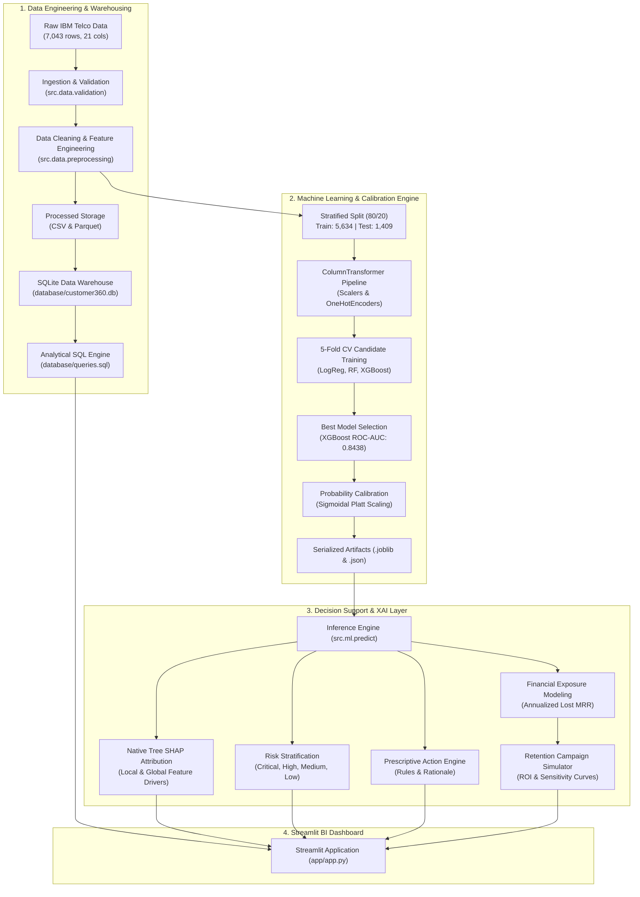

# CUSTOMER360 AI — System Architecture Specification

## 1. System Overview

**CUSTOMER360 AI** is engineered as a modular, production-oriented analytics and decision intelligence platform. It decouples data ingestion, validation, analytical warehousing, model training, explainable inference, and presentation into distinct, maintainable layers.



---

## 2. Directory Structure

```
CUSTOMER360 AI/
├── app/                              # Streamlit application UI layer
│   ├── app.py                        # Main dashboard controller and navigation
│   └── components/                   # Modular dashboard views
│       ├── __init__.py
│       ├── styles.py                 # Custom CSS and Plotly styling
│       ├── executive.py              # Macro enterprise KPIs and revenue exposure
│       ├── analytics.py              # Cohort diagnostics & live SQL runner
│       ├── prediction.py             # Single & batch prediction interface
│       ├── explainability_view.py    # Global & local SHAP feature attribution
│       ├── retention_sim.py          # Interactive retention campaign ROI simulator
│       ├── performance.py            # Model comparison, ROC/PR, & calibration
│       └── data_quality.py           # Provenance report & data dictionary
├── data/
│   ├── raw/                          # Original immutable IBM Telco dataset
│   │   ├── Telco-Customer-Churn.csv
│   │   └── provenance_metadata.json
│   └── processed/                    # Cleaned and feature-engineered datasets
│       ├── cleaned_telco_churn.csv
│       └── cleaned_telco_churn.parquet
├── database/                         # Analytical database layer
│   ├── customer360.db                # SQLite database with indexed tables
│   ├── schema.sql                    # DDL schema definition with analytical indexes
│   └── queries.sql                   # 10 production SQL analytics queries
├── docs/                             # Project documentation
│   ├── architecture.md               # System architecture and data flow
│   ├── cv_project_description.md     # Resume bullet points
│   └── interview_preparation_guide.md # Technical interview Q&A guide
├── models/                           # Serialized machine learning artifacts
│   ├── best_model.joblib             # Primary trained XGBoost classifier
│   ├── calibrated_model.joblib       # Probability-calibrated classifier
│   ├── preprocessor.joblib           # Fitted ColumnTransformer pipeline
│   ├── logistic_regression.joblib    # Baseline Logistic Regression
│   ├── random_forest.joblib          # Candidate Random Forest
│   ├── xgboost_model.joblib          # Candidate XGBoost model
│   ├── model_metrics.json            # Verified evaluation benchmarks
│   ├── feature_importances.json      # Global feature importance scores
│   └── feature_names.json            # Transformed feature column names
├── src/                              # Core Python engineering modules
│   ├── __init__.py
│   ├── config.py                     # Constants, file paths, and hyperparameters
│   ├── database.py                   # SQLite manager and query execution methods
│   ├── decision_intelligence.py      # Risk tiers, CLV, prescriptive actions, & simulator
│   ├── explainability.py             # Native Tree SHAP attribution engine
│   ├── data/
│   │   ├── __init__.py
│   │   ├── ingestion.py              # Dataset acquisition & provenance logging
│   │   ├── validation.py             # Schema, duplicate, and missing-value validation
│   │   └── preprocessing.py          # Data cleaning and feature engineering pipelines
│   └── ml/
│       ├── __init__.py
│       ├── train.py                  # Model training, 5-fold CV, calibration, evaluation
│       └── predict.py                # Single & batch inference scoring service
├── tests/                            # Comprehensive Pytest automated test suite
│   ├── test_data_validation.py       # Data health and schema integrity tests
│   ├── test_preprocessing.py         # Cleaning and pipeline transformation tests
│   ├── test_database.py              # SQLite connectivity and SQL logic tests
│   ├── test_ml_models.py             # Model artifact and CV benchmark tests
│   ├── test_inference.py             # Single and batch inference tests
│   ├── test_explainability.py        # Tree SHAP attribution tests
│   ├── test_decision_intelligence.py # Risk tier and simulation logic tests
│   └── test_app_integration.py       # UI component integration tests
├── .gitignore                        # Git exclusion rules
├── README.md                         # Recruiter-facing project documentation
└── requirements.txt                  # Minimal, reproducible production dependencies
```

---

## 3. Database Schema Specification

The `customers` table in `database/customer360.db` is created with high-performance analytical indexes:

```sql
CREATE TABLE customers (
    customerID TEXT PRIMARY KEY,
    gender TEXT NOT NULL,
    SeniorCitizen INTEGER NOT NULL,
    Partner TEXT NOT NULL,
    Dependents TEXT NOT NULL,
    tenure INTEGER NOT NULL,
    PhoneService TEXT NOT NULL,
    MultipleLines TEXT NOT NULL,
    InternetService TEXT NOT NULL,
    OnlineSecurity TEXT NOT NULL,
    OnlineBackup TEXT NOT NULL,
    DeviceProtection TEXT NOT NULL,
    TechSupport TEXT NOT NULL,
    StreamingTV TEXT NOT NULL,
    StreamingMovies TEXT NOT NULL,
    Contract TEXT NOT NULL,
    PaperlessBilling TEXT NOT NULL,
    PaymentMethod TEXT NOT NULL,
    MonthlyCharges REAL NOT NULL,
    TotalCharges REAL NOT NULL,
    Churn TEXT NOT NULL,
    Churn_Binary INTEGER NOT NULL,
    tenure_group TEXT NOT NULL,
    security_services_count INTEGER NOT NULL,
    streaming_services_count INTEGER NOT NULL,
    total_addon_services INTEGER NOT NULL,
    has_internet INTEGER NOT NULL
);

CREATE INDEX idx_customers_churn ON customers(Churn);
CREATE INDEX idx_customers_contract ON customers(Contract);
CREATE INDEX idx_customers_tenure_group ON customers(tenure_group);
CREATE INDEX idx_customers_internet ON customers(InternetService);
CREATE INDEX idx_customers_payment ON customers(PaymentMethod);
```
